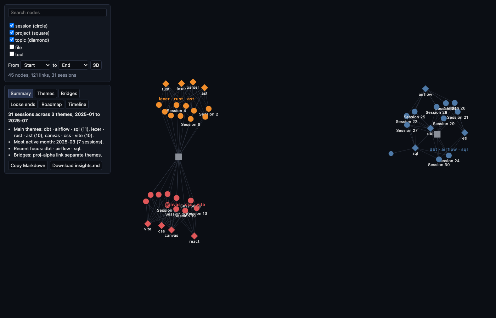

# Graph insights, part 2: analysis, insights and the 2D map - Knowledge base article

Waddaya Solutions Private Limited · KBA · 2026-11-01-graph-map

| Field | Value |
|---|---|
| Article ID | KBA-2026-11-01-graph-map |
| Type | How-to (it explains how the theme analysis, the plain-words insights and the 2D map were built and checked, so the work can be repeated or extended) |
| Version | 1.0 |
| Date | 2026-11-02 00:50 |
| Status | Complete |
| Risk level | Medium - 1 person approves the merge |
| Phases | 3 of 3 |
| Commits | 913cb82, 8d31ca1, 98cf4a4 |

## Summary in plain words
The explorer showed 2,571 nodes as a 3D "hairball" that was hard to read. We wanted to see the main themes, the one-off topics, the links and gaps between themes, and how interests changed over time. We built three things in three phases. First, an analysis step that groups sessions into themes, ranks them and builds a month-by-month timeline. Second, an insights step that turns the analysis into a short plain-words summary and roadmap that can be exported as Markdown. Third, a flat 2D map with theme colours and names, an insights panel, a month filter and a toggle back to 3D. Everything runs in the browser from `graph.json`. No AI model or online service is called. We know it works because the tests were written first and failed, then passed, the quality check (the gate) passed for every phase, and each phase passed its review in round 1 with no Important findings.

## When to use this article (trigger)
- You need to understand how themes, bridges, loose ends, insights or the 2D map work in the explorer.
- You want to extend or debug `explorer/src/analysis.ts`, `explorer/src/insights.ts` or `explorer/src/view.ts`.
- You want to know why a decision was made where the spec was silent (see "Errors and how they were solved").

## Prerequisites and access
- A checkout of the repository on branch `build/graph-map` (cut from `main`, because the part 1 branch was already merged).
- Node.js with npm. Installing the new dependency `force-graph` needs the npm registry once.
- Commands from the project (as recorded):
  - Rust tests: `cargo test --quiet`
  - Rust lint: `cargo clippy --quiet -- -D warnings`
  - Explorer tests: `npx vitest run --exclude 'tests/holdout/**'`
  - Explorer type check: `npx tsc --noEmit`
- The app shell (`main.ts`, `index.html`) is checked by `npm run build` and `tsc --noEmit`, not by unit tests.
- Access to the private conversation data is only needed in the browser. Nothing is sent anywhere.

## Procedure
| # | Time | What we did | Why | Evidence / screenshot |
|---|---|---|---|---|
| 1 | 2026-11-02 00:18 | Wrote the plan for this change (change.md, Medium risk). | Agree what to build and how to undo it before coding. | Plan recorded for `changes/2026-11-01-graph-map` |
| 2 | 2026-11-02 00:21 | Plan approved for phases 10, 11 and 12. | Work starts only after approval. | approve-plan event |
| 3 | 2026-11-02 00:34 | Phase 10 started. Spec approved in advance (AC-10-01 to AC-10-10). Two test files moved in. | Tests come from the spec and are locked, so code cannot bend them. | 2 test files |
| 4 | 2026-11-02 00:34 | Phase 10 tests run before any code: they failed. | Proves the tests really test something. | "Tests 6 failed \| 9 passed (15)" for the hidden tests; visible run showed `Error: not implemented` in `analyzeGraph`, `louvain`, `sessionTopicGraph` |
| 5 | 2026-11-02 00:37 | Phase 10 built: themes (Louvain), PageRank, bridges, one-off topics, loose ends, timeline in `analysis.ts`. Gate run. | The raw graph needs structure a person can read. | Gate: PASS |
| 6 | 2026-11-02 00:38 | Phase 10 review prepared, then reviewed at 00:39. | A second look for mistakes. | Round 1: PASS, 0 Important |
| 7 | 2026-11-02 00:40 | Phase 10 committed. | Save the finished phase. | Commit 913cb82 |
| 8 | 2026-11-02 00:40 | Phase 11 started. Spec approved in advance (AC-11-01 to AC-11-08). Two test files moved in. | Same test-first rule. | 2 test files |
| 9 | 2026-11-02 00:40 | Phase 11 tests run before any code: they failed. | Proves the tests are real. | "Tests 13 failed \| 15 passed (28)" for the hidden tests; visible run showed `Error: not implemented` in `buildInsights` |
| 10 | 2026-11-02 00:40 | Phase 11 built: `insights.ts` with headline, summary lines, themes, roadmap and Markdown export. Gate run at 00:40:57. | Turn the analysis into plain words, with no AI call. | Gate: PASS |
| 11 | 2026-11-02 00:41 | Phase 11 review prepared, reviewed at 00:42. | A second look. | Round 1: PASS, 0 Important |
| 12 | 2026-11-02 00:42 | Phase 11 committed. | Save the finished phase. | Commit 8d31ca1 |
| 13 | 2026-11-02 00:42 | Phase 12 started. Spec approved in advance (AC-12-01 to AC-12-07). Two test files moved in. | Same test-first rule. | 2 test files |
| 14 | 2026-11-02 00:42 | Phase 12 tests run before any code: they failed. | Proves the tests are real. | "Tests 16 failed \| 29 passed (45)" for the hidden tests; visible run showed `Error: not implemented` in `clusterLabels` and `monthRange`, and `force-graph` missing from `package.json` |
| 15 | 2026-11-02 00:44 | Phase 12 built: `view.ts` and the app shell (2D labelled map, insights panel, month filter, 3D toggle, `force-graph` added). First gate run. | Replace the 3D hairball with a readable map. | Gate: PASS (00:44:41) |
| 16 | 2026-11-02 00:47 | Gate run again after the later fixes (see errors 12 to 15). | Make sure the fixes broke nothing. | Gate: PASS (00:47:54) |
| 17 | 2026-11-02 00:48 | Phase 12 review prepared, reviewed at 00:49. | A second look. | Round 1: PASS, 0 Important |
| 18 | 2026-11-02 00:50 | Phase 12 committed, then the final report was written. | Save the finished work. | Commit 98cf4a4.  |

Note: the screenshot in step 18 was taken with synthetic (made-up) data, not real conversations.

Time spent per phase: phase 10 took 5.6 minutes, phase 11 took 2.0 minutes, phase 12 took 7.9 minutes.

## Errors and how they were solved
No gate attempt failed (all four gate runs passed), there were no retests, and no review found an Important issue. The problems below were met while building. Most are places where the spec was silent or unclear. Exact times for each are not recorded; each belongs to the phase window shown.

| # | Time | What went wrong | Cause | How it was solved | How to avoid it next time |
|---|---|---|---|---|---|
| 1 | Phase 10 (00:34-00:40) | Spec says first/last/latest dates are the "smallest/largest started_at string". | Plain string comparison is unclear for timestamps with time-zone offsets. | Compare by `Date.parse` time, with the raw string as tie-break. Same result for UTC ISO strings. | Say in the spec how dates are compared. |
| 2 | Phase 10 | Louvain tie rule ("lower community index") could make a node bounce between equal communities forever. | Equal-gain moves never settle. | A node moves only on a strictly positive gain that is strictly better than staying (epsilon 1e-10). Ties go to the lower index. A cap on passes was added. | Write tie rules so they cannot loop. |
| 3 | Phase 10 | PageRank on a star graph flips back and forth after the default 50 iterations. | The star shape oscillates. | Checked that the leftover error (about 8e-5) is well inside the 3-decimal tolerance. Kept the spec default and normalised the result to sum to 1. | Check tolerance against odd graph shapes early. |
| 4 | Phase 10 | Spec did not say how PageRank treats noisy edges. | Missing rule. | Uses the same edge filter as Louvain: unknown endpoints, self-loops and non-positive or non-finite weights are dropped; parallel edges add up. | State the edge-cleaning rule once for all algorithms. |
| 5 | Phase 10 | "Label ascending" did not say how to sort. | Missing rule. | Plain code-unit string compare (no locale, no lowercasing) so order is the same everywhere. | Name the exact sort in the spec. |
| 6 | Phase 11 | Headline rule gives "2025-03 to 2025-03" when the timeline has a single month. | Spec has no single-month case. | Kept the literal spec, no special case. | Define single-bucket wording in the spec. |
| 7 | Phase 11 | "Bridges: ... link separate themes." reads oddly with one bridge. | Fixed wording in the spec. | Kept the specified and tested wording; only the label list shrinks. | Allow singular wording in the spec. |
| 8 | Phase 11 | "Recent" is unclear for a date after `latestAt`. | Spec says "at or before latestAt" only. | Recent means date <= latestAt and latestAt minus date <= 30 days. Exactly 30 days is in; 31 days is out. | Spell out both edges of a time window. |
| 9 | Phase 11 | Ties in recent focus and theme order could depend on array order in hand-built analyses. | Order not guaranteed. | Compare by lower community id explicitly. | Never rely on array order for ties. |
| 10 | Phase 11 | Share of sessions could be wrong. | Dividing by sessions inside themes only. | Count all session nodes in the graph and guard against zero. | Check the denominator and the empty case. |
| 11 | Phase 11 | Pipe characters in theme names break the Markdown table. | `\|` separates table columns. | Escape `\|` as `\\\|` in table cells only. | Escape user text before putting it in a table. |
| 12 | Phase 12 | Unclear whether removing orphans (files, tools, topics, projects with no kept session) applies without a month range. | Spec silent. | Applies with or without a range, but only when "session" is among the visible types. | Decide orphan rules in the spec. |
| 13 | Phase 12 | Unclear what happens to sessions with a missing or invalid `started_at`. | Spec silent. | Dropped only when a From or To month is set; kept otherwise. "Invalid" means not a string, `Date.parse` gives NaN, or the first 7 characters are not YYYY-MM. The From/To selects only offer keys matching `/^\d{4}-\d{2}$/`, because the phase 10 month key is the first 7 characters of the date. | Validate dates once, in one place. |
| 14 | Phase 12 | `tsc --noEmit` failed with TS2591 on `node:fs` and `node:url` in `tests/view.test.ts`. | Node types not in the TypeScript config. | Added "node" to the `types` list in tsconfig. | Add Node types when tests import Node modules. |
| 15 | Phase 12 | First 2D render showed the whole graph tiny in the middle of the canvas. | Map not zoomed to fit. | `cooldownTicks(250)` plus `zoomToFit` on `onEngineStop`, only after a data change. | Always fit the view after layout settles. |
| 16 | Phase 12 | The 2D canvas sat under the left panels, so zoom-to-fit hid clusters behind them. | Canvas used the full width. | The 2D container starts at x=324px and `width2d()` accounts for it. The 3D view still uses the full width. | Size the canvas to the free space. |
| 17 | Phase 12 | `force-graph` default node and link tooltips read labels as HTML (a risk of script injection). | Library default. | `nodeLabel` returns `escapeHtml(label)` and `linkLabel` returns an empty string. Everything else is built with `textContent`. Tested with a session labelled ``: it shows as text, 0 img elements were injected, no dialog. | Escape every label before it goes into HTML. |
| 18 | Phase 12 | `main.ts` was patched twice with a script instead of the Edit tool. | Small changes made quickly. | Recorded as a process note. `tsc` and the gate pass. | Use the normal edit tool so changes are easy to review. |

## Verification
- Failing first: every phase's tests were run before the code existed and failed (phase 10: 6 failed, 9 passed of 15 hidden tests; phase 11: 13 failed, 15 passed of 28; phase 12: 16 failed, 29 passed of 45). The failures were `Error: not implemented`, plus the missing `force-graph` entry in `package.json` for phase 12. These counts are as recorded for the hidden tests, which are tests kept out of the builder's sight.
- Passing: the gate passed for phase 10 (00:37), phase 11 (00:40) and phase 12 (00:44 and 00:47). The exact passing test counts after the build are not recorded.
- Reviews: phase 10, 11 and 12 each passed in round 1 with 0 Important findings and 0 pre-existing issues.
- Safety check: a session labelled with an HTML image tag displayed as plain text; no element was injected and no dialog opened.
- Screenshot: see step 18 (synthetic data).
- Risk stayed Medium. No high-risk files were touched. `package.json` changed because `force-graph` was added.

## How to undo
Revert the phase commits (98cf4a4, 8d31ca1, 913cb82). `graph.json` and the notes are not changed by this part, so nothing else needs restoring.

## Words explained
| Word | Meaning in plain English |
|---|---|
| KBA | Knowledge base article: a written guide like this one. |
| Phase | One slice of the work, built, checked and saved on its own. |
| Spec | The written description of what a phase must do, with numbered rules. |
| Acceptance criteria (AC-10-01 etc.) | The numbered rules in a spec that the tests check. |
| Plan approved | A person agreed the plan before coding started. |
| Test written first / failing first (red) | Tests are run before the code exists to prove they fail, so a later pass means something. |
| Hidden test | A test kept out of the builder's sight so the code cannot be shaped to fit it. |
| Gate | An automatic quality check (tests and type checks) that must pass before a phase is saved. |
| Review round | A second check of the work by a reviewer. Round 1 means the first check. |
| Important finding | A review problem serious enough to need fixing before moving on. |
| Commit | A saved snapshot of the code with a short id such as 98cf4a4. |
| Revert | Undo a commit by adding a new commit that reverses it. |
| Branch | A separate line of work in git; here `build/graph-map`. |
| Graph / `graph.json` | The file of sessions, topics, projects, files and tools, and the links between them. |
| Session | One recorded conversation. |
| Topic | A subject a session talked about. |
| Theme (community) | A group of sessions and topics that belong together, found automatically. |
| Louvain | A method that finds themes by grouping nodes that link strongly to each other. |
| PageRank | A method that scores how central a node is, based on what links to it. |
| Bridge | A topic used by sessions of two different themes. |
| One-off topic | A topic used by only one session. |
| Loose end | A theme of at most 3 sessions, untouched for over 30 days before the latest session. |
| Timeline | The count of sessions per month. |
| Insights | A short plain-words summary and roadmap made from the analysis, without an AI call. |
| Roadmap | "Continue" items for recently active themes, then "Decide" items for loose ends. |
| Orphan | A node left with no link to a kept session. |
| Tie-break | A rule for choosing between two equal options. |
| Epsilon | A very small number used to ignore tiny rounding differences. |
| Tooltip | The small box shown when the mouse is over a node. |
| `tsc --noEmit` | A TypeScript check for type mistakes that does not build any files. |
| Synthetic data | Made-up data used for a screenshot so no real conversations are shown. |
| `force-graph` | The library that draws the flat 2D map. |
