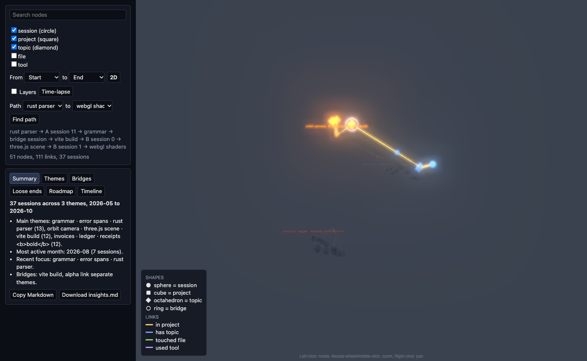

# Give the third dimension a job: time, themes, layers and paths in the 3D map - Knowledge base article

Waddaya Solutions Private Limited · KBA · 2026-11-02-graph-3d

| Field | Value |
|---|---|
| Article ID | KBA-2026-11-02-graph-3d |
| Type | How-to (it explains how the 3D map was built and how to check it; it is not an operations runbook) |
| Version | 1.0 |
| Date | 2026-11-02 |
| Status | Complete |
| Risk level | Medium - 1 person approves the merge |
| Phases | 4 of 4 |
| Commits | 226d0a6, c6b72af, 9d2df89, f308bdd |

## Summary in plain words
The explorer shows our notes as a map of dots (nodes) and lines (links). The 3D version was only a worse copy of the 2D map. Depth meant nothing. We made depth carry meaning. Sessions are placed along the depth axis by date, so flying through the map reads like a history. Each theme becomes an island with its name floating above it. Size and brightness show data. We added a layers switch, a time-lapse button, a path finder ("how did topic X lead to topic Y?"), and insights tabs that move the camera. We also improved the look: shapes per type, fog, glow, faint coloured links. The work was done in four phases. In each phase the tests were written first and shown to fail, then the code was built until they passed. A reviewer checked each phase. The final result is 4 of 4 phases done, with every gate (the automatic check before a commit) passed.

## When to use this article (trigger)
- You need to understand how the 3D map decides where nodes sit and how they look.
- You are changing `explorer/src/scene3d.ts`, `main.ts` or `index.html` for the 3D view.
- You need to review, test or undo this change.

## Prerequisites and access
- A checkout of the repository on the branch `build/graph-3d`.
- Node and npm for the explorer. Rust for the core.
- Commands recorded for this change:
  - Core tests: `cargo test --quiet`
  - Core lint: `cargo clippy --quiet -- -D warnings`
  - Explorer tests: `npx vitest run --exclude 'tests/holdout/**'`
  - Explorer type check: `npx tsc --noEmit`
- Also named in the change description: `npm run build` and a look in the browser (rendering and wiring are checked this way).
- Approval: 1 person approves the merge.
- Dependencies: `three` is pinned to 0.179.x (the installed 0.187 moves down to 0.179.1). `@types/three` was added as a dev-only, type-only package.

## Procedure
| # | Time | What we did | Why | Evidence / screenshot |
|---|---|---|---|---|
| 1 | 2026-11-02 10:36 | Wrote the plan for the change (4 phases: 13 to 16). | To agree on the scope before building. | Plan event recorded |
| 2 | 2026-11-02 10:41 | Plan approved for phases 13, 14, 15, 16. | Nothing is built without approval. | Approval event recorded |
| 3 | 2026-11-02 10:47 | Phase 13 started. Spec approved (AC-13-01 to AC-13-09). Tests moved in. | The spec says what "done" means. | 2 test files moved in |
| 4 | 2026-11-02 10:47 | Phase 13: ran the tests before any code. | To prove the tests fail without the feature. | Hidden tests: "8 failed \| 45 passed (53)"; visible failures read "Error: not implemented" (for example `bridgeIds`) |
| 5 | 2026-11-02 10:48 | Phase 13 built: layout maths (time axis, island centres, layer z, size, brightness, bridge set) in `explorer/src/scene3d.ts`. | Pure functions decide where each node sits and how it looks. | Gate 10:48 PASS |
| 6 | 2026-11-02 10:49 | Phase 13 review round 1. | An independent check of the work. | Verdict PASS, 0 Important |
| 7 | 2026-11-02 10:50 | Phase 13 committed. | Save the finished phase. | Commit 226d0a6 |
| 8 | 2026-11-02 11:03 to 11:07 | Prepared (prefetched) phases 14, 15, 16 ahead of time. | To save waiting time. | Ready: 14, 15, 16; dropped: none |
| 9 | 2026-11-02 11:07 | Phase 14 started. Spec approved (AC-14-01 to AC-14-09). Tests moved in. | Same as phase 13. | 2 test files moved in |
| 10 | 2026-11-02 11:08 | Phase 14: ran the tests before any code. | Prove they fail first. | Hidden tests: "8 failed \| 53 passed (61)"; visible failures: `orbitPosition ... Error: not implemented` |
| 11 | 2026-11-02 11:08 | Phase 14 built: link filter and colours, shortest path, time-lapse stepping, orbit maths. | Pure helpers behind clutter-free links, the path finder, the time-lapse and the camera orbit. | Gate 11:08 PASS |
| 12 | 2026-11-02 11:09 | Phase 14 review round 1, then commit. | Check and save. | PASS, 0 Important; commit c6b72af |
| 13 | 2026-11-02 11:09 | Phase 15 started. Spec approved (AC-15-01 to AC-15-05). Tests moved in. | Same as above. | 2 test files moved in |
| 14 | 2026-11-02 11:10 | Phase 15: ran the tests before any code. | Prove they fail first. | Hidden tests: "3 failed \| 61 passed (64)"; visible failure: `index.html` has no element with id `legend` |
| 15 | 2026-11-02 11:16 | Phase 15 built: shapes, fog, bloom (glow), particles, legend, camera fit, auto-rotate, view starts right of the panels. | Make the 3D view readable and match 2D. | Gate 11:16 PASS |
| 16 | 2026-11-02 11:24 | Phase 15 review round 1. | Check the work. | Verdict FAIL, 1 Important (see Errors) |
| 17 | 2026-11-02 11:25 | Fixed the findings. Gate ran again. | Reviewer asked for fixes. | Gate 11:25 PASS |
| 18 | 2026-11-02 11:28 | Phase 15 review round 2, then commit. | Confirm the fixes. | PASS, 0 Important; commit 9d2df89 |
| 19 | 2026-11-02 11:28 | Phase 16 started. Spec approved (AC-16-01 to AC-16-06). Tests moved in. | Same as above. | 2 test files moved in |
| 20 | 2026-11-02 11:28 | Phase 16: ran the tests before any code. | Prove they fail first. | Hidden tests: "4 failed \| 64 passed (68)"; visible failures: no element with id `path-from`, `path-go`, `path-result` |
| 21 | 2026-11-02 11:39 | Phase 16 built: time and island forces, theme labels, layers switch, time-lapse button, path picker, tabs that steer the camera. | Give depth its job. | Gate 11:39 PASS |
| 22 | 2026-11-02 11:43 | Gate ran again after more edits. | Re-check before review. | Gate 11:43 PASS |
| 23 | 2026-11-02 11:47 | Phase 16 review round 1, then commit. | Check and save. | PASS, 0 Important; commit f308bdd |
| 24 | 2026-11-02 11:48 | Final report written. | Close the change. |  |

## Errors and how they were solved
No gate attempt failed. No retests were needed (0 in every phase). The items below are the problems recorded in the phases.

| # | Time | What went wrong | Cause | How it was solved | How to avoid it next time |
|---|---|---|---|---|---|
| 1 | 2026-11-02 11:24 (phase 15 review round 1, FAIL, 1 Important) | `@types/three` was flagged as an unplanned package. | It was needed for `tsc --noEmit` but not in the plan. The recorded bug type is "unplanned dependency". The exact Important finding text is not recorded. | The user approved it and `change.md` was updated. Three small nits were fixed. Round 2 passed. | List type packages in the plan when adding a library. |
| 2 | 2026-11-02 phase 15 | Node objects were rebuilt on every filter change. | The graph library gets copied nodes. | Stored node looks are cleared on each 3D filter. A wrong comment was corrected. | Remember the library copies nodes; do not cache looks on them. |
| 3 | 2026-11-02 phase 15 | Bloom (glow) render targets had the wrong size on high-density screens. | The HiDPI pixel ratio was not used. | The composer is resized after the bloom and output passes are added. | Always size render targets with the pixel ratio. |
| 4 | 2026-11-02 phase 15 | Node sizes were recomputed for every node on every filter change. | Sizes were calculated inside the filter path. | Sizes are computed once per loaded graph and looked up by id. | Compute fixed data once per load. |
| 5 | 2026-11-02 phase 16 | The spec mentions `forceZ`, but `d3-force-3d` is not a direct dependency. | The package is not directly available. | Custom x, y and z axis forces were written on the graph instance. | Check dependencies before writing a spec that names a library function. |
| 6 | 2026-11-02 phase 16 | Filter changes re-create 3D nodes. | Same copy behaviour as item 2. | x, y, z and velocities are carried over by id, so the time-lapse stays smooth. | Carry state over by id when nodes are re-created. |
| 7 | 2026-11-02 phase 16 | Risk of unsafe text in theme names. | Names come from data. | Theme names are drawn on canvas or set via `textContent`, never `innerHTML`. | Never put data into `innerHTML`. |

Other notes: phase 16 review found 1 pre-existing issue (details not recorded). Three nits were left as they are: time-lapse end range, label truncation by code points, and idle-rotate pause on an empty click. Phases 13 and 14 had no problems.

## Verification
- Tests failed first in every phase, with "Error: not implemented" or missing page elements (see Procedure steps 4, 10, 14, 20). Hidden test counts before the code: 8 failed (phase 13), 8 failed (phase 14), 3 failed (phase 15), 4 failed (phase 16).
- All gates passed: phase 13 once, phase 14 once, phase 15 twice, phase 16 twice.
- Review verdicts: phase 13 PASS, phase 14 PASS, phase 15 FAIL then PASS, phase 16 PASS.
- The final pass counts after the code were built are not recorded.
- The screenshot `screenshots/phase-16-path.png` shows the path picker.
- Rendering and wiring in `main.ts` and `index.html` are meant to be checked with `npm run build`, `npx tsc --noEmit` and a look in the browser.

## How to undo
Revert the phase commits (226d0a6, c6b72af, 9d2df89, f308bdd). The 2D map comes back with the first commit on this branch. Revert that one too if you want to drop the 2D map.

## Words explained
| Word | Meaning in plain English |
|---|---|
| Phase | One slice of the change, built and checked on its own. |
| Gate | The automatic check (tests, type check) that must pass before a commit. |
| Commit | A saved snapshot of the code in git. |
| Spec | A short document listing what the phase must do. |
| Acceptance criteria (AC) | The numbered rules the spec lists, for example AC-13-01. |
| Hidden test | A test the builder cannot see while coding. It stops the code from only fitting the visible tests. |
| Failing first (red) | Running the tests before the code exists, to prove they fail. |
| Review round | One check of the work by a reviewer. A FAIL means fixes are needed. |
| Important finding | A review problem serious enough to block the phase. |
| Nit | A small, minor review comment. |
| Node / link | A dot on the map and a line between two dots. |
| Session, topic, project | The kinds of node on the map. |
| Theme / island | A group of related nodes. In 3D it is drawn as an island. |
| Bridge topic | A topic that connects different themes. It gets a ring. |
| Time-lapse | A button that steps through the months one at a time. |
| Bloom | A soft glow effect. |
| Fog | Distant things fade, which gives a feeling of depth. |
| HiDPI pixel ratio | Sharp screens have more pixels than the page size. The glow must account for that. |
| Pure function | Code that only turns inputs into outputs and changes nothing else. Easy to test. |
| `three` | The library that draws 3D graphics in the browser. |
| `@types/three` | A dev-only package that tells the type checker what `three` looks like. |
| `tsc --noEmit` | The type check. It looks for type errors and writes no files. |
| Prefetch | Preparing later phases while an earlier one finishes. |
| Risk level | How careful the approval must be. Medium here: 1 person approves the merge. |
